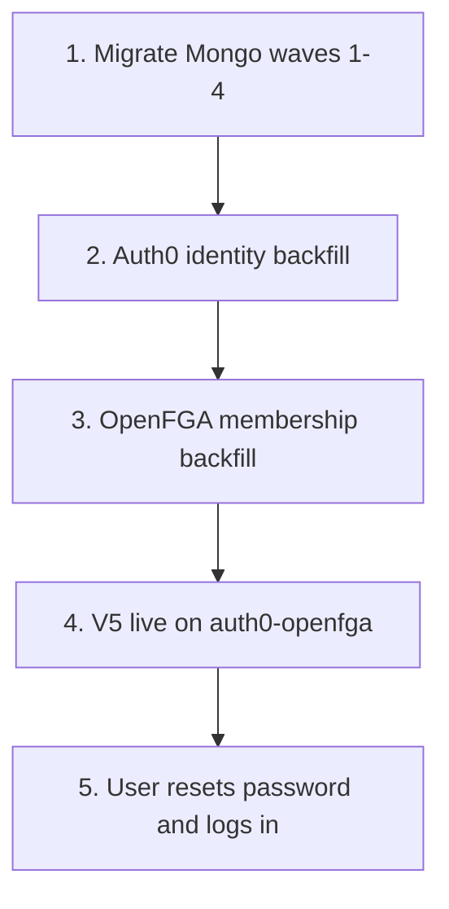

# V4 → V5 user cutover runbook

**Purpose:** One place for ops to take V4 customers onto V5 — migrate data, link Auth0 logins, project OpenFGA roles, then let users sign in.

**Do not confuse environments.** The same commands work locally and in prod; only the **env / secrets** decide which Mongo, Auth0 tenant, and OpenFGA store you hit. Wrong `.env` = wrong world.

**Related detail docs** (this file is the ordered checklist; those are deep dives):

- [V4_V5_CORE_MIGRATION.md](./V4_V5_CORE_MIGRATION.md) — waves, field maps, CLI flags  
- [AUTH0_IDENTITY_BACKFILL.md](../security/AUTH0_IDENTITY_BACKFILL.md) — Auth0 identity script  
- [OPENFGA_MEMBERSHIP_BACKFILL.md](../security/OPENFGA_MEMBERSHIP_BACKFILL.md) — role tuples  
- [CUTOVER_CHECKLIST.md](../security/CUTOVER_CHECKLIST.md) — broader auth smoke  

All commands below run from `ims-systems-v5-backend` unless noted.

---

## What “ready for users” means

A V4 person can use V5 when **all** of these are true for their organisation:

1. Their org’s **data** is in V5 Mongo (migration waves 1–4, optionally 6).  
2. Their **Auth0** user + org membership exist, and Mongo has `auth0SubjectId` / `auth0OrganizationId` (identity backfill).  
3. Their **OpenFGA** membership tuples exist (role backfill).  
4. V5 **app** is deployed with `SECURITY_PROVIDER=auth0-openfga` (and matching frontend Auth0 env).  
5. They **set a password** (Auth0 reset / Forgot password — V4 passwords do **not** carry over) and log into the V5 URL.

Until steps 1–4 are done for that org, Forgot password alone will **not** put them into V5 with their data.



---

## Prerequisites (before any prod cutover)

### Target env checklist

| Item | Notes |
| ---- | ----- |
| `MONGODB_URI` | **V5** target DB (prod Mongo for prod cutover) |
| `V4_MONGO_URI` | V4 cluster URI prefix (no DB name), e.g. `mongodb://host:27017` |
| `V4_ADMIN_DB` / `V4_TENANT_DBS` or `--tenant=` | Which V4 tenant DB(s) to migrate |
| `SECURITY_PROVIDER` | `auth0-openfga` |
| `AUTH0_DOMAIN` | Target Auth0 tenant (prod vs dev) |
| `AUTH0_MGMT_CLIENT_ID` / `AUTH0_MGMT_CLIENT_SECRET` | M2M app for Management API |
| `AUTH0_SPA_CLIENT_ID` (or ROPG client) | Used for change-password emails |
| `AUTH0_DB_CONNECTION` | Usually `Username-Password-Authentication` |
| `OPENFGA_API_URL` / `OPENFGA_STORE_ID` / `OPENFGA_MODEL_ID` | Target OpenFGA store |
| Frontend | `VITE_SECURITY_PROVIDER=auth0-openfga` + public Auth0 SPA settings |
| Files / email / Stripe | Prod S3, email provider, Stripe live/test as appropriate |

### Auth0 M2M scopes (Management API)

Grant at least: `read:users`, `create:users`, `update:users`, `read:organizations`, `create:organizations`, `update:organizations`, `create:organization_members`, `create:organization_connections`, `read:connections`.

### Product notes

- Parked V4 domains (CQC, Carbon Calculator, IMS Projects/Forms, etc.) are **not** in the V5 product UI; Wave 6 can archive them as `legacy_*` for durability only.  
- Tell users the **V5 URL** and that they must **set a new password**.

---

## Phase A — Migrate data (Mongo)

Prefer a **pilot org / tenant** before `--all` / every tenant.

```bash
cd ims-systems-v5-backend

# 0) Inventory (no writes)
pnpm migrate:v4 --wave=0 --dry-run --tenant=<v4_tenant_db>

# Optional: compliance catalogues before Wave 4
pnpm seed:compliance-catalogues

# Dry-run full core migrate
pnpm migrate:v4 --wave=1-4 --dry-run --tenant=<v4_tenant_db>

# Apply core data
pnpm migrate:v4 --wave=1-4 --tenant=<v4_tenant_db> --report=./tmp/migrate-report.json

# Validate a wave
pnpm migrate:v4 --wave=3 --validate-only --tenant=<v4_tenant_db>

# Optional: archive parked collections as legacy_*
pnpm migrate:v4 --wave=6 --tenant=<v4_tenant_db>
```

**Prod habit:** freeze or read-only V4 writes → final delta `pnpm migrate:v4 --wave=1-4` → keep V4 DBs as backup.

Wave 5 of the migrator only **prints** the Auth0/OpenFGA runbook; it does not create Auth0 users. Use Phase B/C below.

---

## Phase B — Auth0 identity backfill

Creates/links Auth0 orgs + users, sets Mongo `auth0OrganizationId` / `auth0SubjectId`, adds Auth0 org membership. By default a **real apply sends Auth0 change-password emails**.

```bash
# Pilot one Mongo organisation (recommended first)
pnpm backfill:auth0-identities --organization-id=<mongoOrgId> --dry-run
pnpm backfill:auth0-identities --organization-id=<mongoOrgId> --no-send-reset-email   # link only, no mail
# or allow emails:
pnpm backfill:auth0-identities --organization-id=<mongoOrgId>

# All orgs that have memberships (prod when ready)
pnpm backfill:auth0-identities --all --dry-run
pnpm backfill:auth0-identities --all --no-send-reset-email
# or with emails:
pnpm backfill:auth0-identities --all
```

Useful flags: `--force-reset` (resend reset email even if already linked), `--skip-org-provision` (fail if org has no Auth0 org id).

Idempotent: safe to re-run; already-linked users are skipped for create.

**Email policy:** Prefer `--no-send-reset-email` in prod unless you intentionally want Auth0 to mail everyone. Users can still use **Forgot password** on the V5 login page after accounts exist.

---

## Phase C — OpenFGA membership backfill

Projects every Mongo `OrganisationMembership` into OpenFGA (roles). Run **after** Auth0 links for the orgs you care about (or after all identity backfill).

```bash
pnpm backfill:openfga-memberships
```

Idempotent. Requires `SECURITY_PROVIDER=auth0-openfga` and valid `OPENFGA_*`.

---

## Phase D — Turn on V5 for users

1. Deploy / confirm backend + frontend on the target env with Auth0 + OpenFGA (not the local stub).  
2. Optional: `pnpm preflight:prod` (and `--organization-id <id>` for bucket checks).  
3. Communicate to the customer:

   > Use the V5 app URL. Sign in with your **same work email**.  
   > Use **Forgot password** (or the reset email if we sent one), set a **new** password, then pick your organisation.

4. Smoke (at least one non-admin member per pilot org):

   - [ ] Forgot password email arrives / link works  
   - [ ] Login succeeds with org selected  
   - [ ] Sees expected modules for their role  
   - [ ] Spot-check migrated data (docs, tasks, risks, etc.)  

---

## Suggested order for production

| Step | Action | Risk note |
| ---- | ------ | --------- |
| 1 | Confirm env is **prod** Mongo + Auth0 + OpenFGA | Triple-check URI/domain |
| 2 | Migrate pilot tenant waves 1–4 | Dry-run first |
| 3 | Auth0 backfill **one** org with `--dry-run`, then `--no-send-reset-email` | Avoid surprise emails |
| 4 | OpenFGA backfill | Idempotent |
| 5 | Human login smoke on pilot | Fix before scale |
| 6 | Migrate remaining tenants | Same as step 2 |
| 7 | Auth0 `--all` (still prefer `--no-send-reset-email` unless mailing is approved) | Emails are real |
| 8 | OpenFGA backfill again | Catches new memberships |
| 9 | Announce V5 URL + Forgot password | Users self-serve password |
| 10 | Keep V4 read-only backup for a freeze window | Rollback / audit |

---

## What users do (no ops required per person after backfill)

1. Open V5 URL.  
2. Enter V4 email → **Forgot password** (if they have no password yet).  
3. Set password in Auth0.  
4. Log in → select organisation.  

You do **not** invent accounts by hand if identity backfill already ran for that org.

---

## Local vs prod (same commands)

| | Local / staging pilot | Production |
| - | --------------------- | ---------- |
| Env file / secrets | Dev Mongo + Auth0 + OpenFGA | **Prod** Mongo + Auth0 + OpenFGA |
| Migrate | `--tenant=…` against local V5 DB | Same flags, prod `MONGODB_URI` / `V4_*` |
| Auth0 | `--organization-id=…` then maybe `--all` | Dry-run → pilot → `--all` |
| Emails | Easy to spam real people if Auth0 is shared | Prefer `--no-send-reset-email` until approved |
| OpenFGA | `pnpm backfill:openfga-memberships` | Same |

Example local pilot (Blue Manufacturing, already used in programme):

```bash
pnpm backfill:auth0-identities --organization-id=65cdfa93b05b1d6e6f4a392c --dry-run
pnpm backfill:auth0-identities --organization-id=65cdfa93b05b1d6e6f4a392c --no-send-reset-email
pnpm backfill:openfga-memberships
```

---

## Verify (quick)

```js
// Mongo shell / Compass — users still missing Auth0 link
db.users.countDocuments({
  deletedAt: null,
  $or: [{ auth0SubjectId: null }, { auth0SubjectId: { $exists: false } }],
});

// Orgs missing Auth0 org link
db.organisations.countDocuments({
  $or: [
    { auth0OrganizationId: null },
    { auth0OrganizationId: { $exists: false } },
  ],
});
```

Also: Auth0 Dashboard → Users / Organizations; OpenFGA store → spot-check tuples for a known `user:{id}` / `organization:{id}`.

---

## Troubleshooting

| Symptom | Likely cause |
| ------- | ------------ |
| Forgot password “works” but login has no org / no data | Identity backfill not run for that org, or wrong Auth0 tenant |
| Login 403 on org APIs | OpenFGA backfill missing or wrong store/model |
| Management API HTTP 403 | Missing M2M scopes on Auth0 app |
| “Connection not found” | `AUTH0_DB_CONNECTION` missing / not enabled on Auth0 Organization |
| Reset emails not arriving | Auth0 email provider / spam; or you used `--no-send-reset-email` (use Forgot password) |
| Data empty in UI but Mongo has rows | Wrong org selected, role/filter, or list filters — not always a migration miss |

---

## Out of scope for this cutover

- Migrating V4 password hashes into Auth0 (unsupported — reset is the path).  
- Bringing parked modules into the V5 product UI.  
- Full S3/file history rewrite (separate files/bucket work).  

---

## One-page command cheat sheet

```bash
cd ims-systems-v5-backend

# Data
pnpm migrate:v4 --wave=0 --dry-run --tenant=<v4_db>
pnpm migrate:v4 --wave=1-4 --dry-run --tenant=<v4_db>
pnpm migrate:v4 --wave=1-4 --tenant=<v4_db>
pnpm migrate:v4 --wave=6 --tenant=<v4_db>          # optional legacy archive

# Auth continuity
pnpm backfill:auth0-identities --organization-id=<mongoOrgId> --dry-run
pnpm backfill:auth0-identities --organization-id=<mongoOrgId> --no-send-reset-email
pnpm backfill:auth0-identities --all --dry-run     # when scaling
pnpm backfill:auth0-identities --all --no-send-reset-email
pnpm backfill:openfga-memberships

# Users: V5 URL → Forgot password → set password → login → pick org
```
