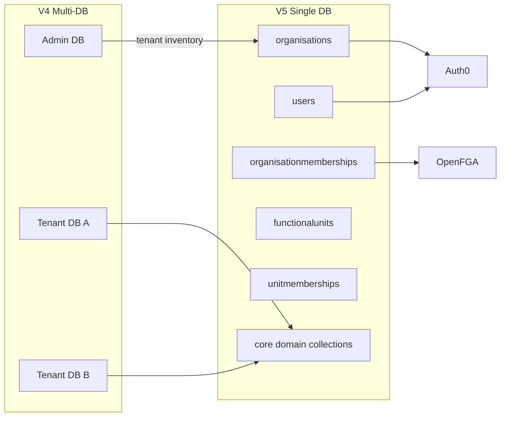

# V4 → V5 Core Domain Migration

**Status:** Active programme  
**ADR:** [D-26](../decisions/0026-v4-v5-core-migration-tooling.md) (supersedes D-18 for tooling)  
**Tooling:** [`ims-systems-v5-backend/scripts/migrate-v4/`](../../ims-systems-v5-backend/scripts/migrate-v4/)

## Decisions

| Decision | Choice |
| -------- | ------ |
| Scope | **Core V5 domains only** |
| Orphan domains | Parked in V4 tenant DBs (CQC, Carbon Calculator, IMS Projects, IMS Forms, expense/worklog/staff alerts, persisted dashboards) |
| IDs | Preserve Mongo `_id`; FKs stored as **strings** |
| Tenancy | V4 per-tenant DB → V5 single DB + `organizationId` |
| Auth | Mongo first → Auth0 link → OpenFGA membership backfill |
| CSV wizard | **Not** used for production cutover |

## Architecture



## Collection renames

| V4 | V5 model / default collection |
| -- | ----------------------------- |
| `organizations` | `Organisation` → `organisations` |
| `groups` | `FunctionalUnit` → `functionalunits` |
| `grouppremises` | `BusinessPremise` → `businesspremises` |
| `memberships` | `OrganisationMembership` → `organisationmemberships` |
| `cips` | `Ofi` → `ofis` |
| `calenderevents` | `CalendarEvent` → `calendarevents` |
| Most others | Same plural name (insert via V5 models) |

## Global field transforms

| V4 | V5 |
| -- | -- |
| `organization` (ObjectId) | `organizationId` (string) |
| `group` | `businessUnitId` or `groupId` (per module) |
| `memberships.groups[]` | Derive `UnitMembership` rows |
| `source.module` | `source.moduleId` |
| ObjectId user/owner refs | string ids |
| Invitation `token` | SHA-256 → `tokenHash` |
| Live docs | `deletedAt: null` |

### Polymorphic `moduleType`

V5 still uses V4 collection-style module types for many links (`cips` for OFI sources/activities). The migrator map in `module-type-map.ts`:

- Keeps `cips` where V5 services expect it (`OFI_SOURCE_MODULE`, activities, tags).
- Maps chart sources that already use `ofi` only when the target field is chart-specific.
- Leaves parked-domain module types unchanged (those docs are not migrated).

## Migration waves

### Wave 0 — Inventory

- List admin tenants / V4 DB names.
- Count core vs parked collections.
- Dry-run report + optional compliance catalogue seed (`pnpm seed:compliance-catalogues`).

### Wave 1 — Identity spine

1. `organizations` → `Organisation`
2. `users` → `User` (cross-tenant email dedupe: keep first, remap later refs)
3. `memberships` → `OrganisationMembership`
4. `groups` → `FunctionalUnit`
5. Derive `UnitMembership` from `memberships.groups[]`
6. `grouppremises` → `BusinessPremise`
7. `invitations` → `Invitation` (hash token; skip expired)
8. `partnership_programs` → `Partnership`; `licenserequests` → `LicenceRequest`

**Skip:** sessions, accesspolicies, roles, txnEmails, publicaccesstokens, admin apikeys (except tenant inventory).

### Wave 2 — Shared references

- `tagsAndCategories` → `TagAndCategory`
- Attachment storage keys noted for later rewrite (files module / per-org buckets)

### Wave 3 — Operational registers

Assets (5), customers, suppliers, invoices (+ counters), email campaigns + deliveries, risks, incidents, cips→ofi, tasks, audits, activities, calendar, notifications, charts, management reviews, KPI, leaves, document repositories/trees/signatures/reminders.

Skip regenerating `DocumentAccessToken` unless explicitly required.

### Wave 4 — Compliance instances

After catalogue seed: `controlstatuses`, `controlevidence`, `complianceoverviews`.  
Remap global control refs by **toolkit + clause** natural key (not blind `_id` if catalogue was re-seeded).  
Skip `ComplianceAutomationRun`.

### Wave 5 — Auth / AuthZ

1. Auth0 org/user link — [AUTH0_IDENTITY_BACKFILL.md](../security/AUTH0_IDENTITY_BACKFILL.md)
2. `pnpm backfill:openfga-memberships` — [OPENFGA_MEMBERSHIP_BACKFILL.md](../security/OPENFGA_MEMBERSHIP_BACKFILL.md)
3. Cutover — [CUTOVER_CHECKLIST.md](../security/CUTOVER_CHECKLIST.md)
4. Optional `nextNudgeAt` backfill; skip AI history

### Wave 6 — Parked (out of scope)

| Domain | V4 collections (examples) |
| ------ | ------------------------- |
| CQC | `complaints`, `cqcsafeguardings`, `cqcwhistleblows`, `cqcsignificantevents`, `cqcreports`, `cqcoverviews`, `cqcdetails`, `cqctools` |
| Carbon Calculator | `ccparameters`, `cclocations`, `cccalculations`, `cccustomfactors`, `ccfactors`, `ccreports`, `cccarbonreductioninitiatives` |
| IMS Projects | `imsprojects`, `imsprojectworkpackages`, memberships, budgets, materials, reports, schedules, relationships |
| IMS Forms | `imsForms`, `imsFormElements`, `imsFormSubmissions`, `imsFormResponses` |
| Wallet / HR extras | `expensereports`, `worklogs`, `staffalerts`, `walletunits` |
| Dashboards | `dashboards`, `groupdashboards` |

Wave 0 inventory reports counts for these so a later phase can resume.

## Field maps (Wave 1 highlights)

### Organisation

| V4 | V5 |
| -- | -- |
| `_id` | `_id` (preserved) |
| `name`, `industry`, `officeEmail`, `campaignEmail`, `contactNumber` | same |
| `sizeOfOrg` | `sizeOfOrganisation` |
| `address` / `addressStreet` / `addressBuilding` / `addressCity` / `addressPostCode` | `address.line1` / `line2` / `city` / `postCode` (+ defaults for county/country) |
| `status` Active→Running | `status` |
| `licenses` / licence quotas | `licences` |
| `created.by` / `created.on` | `createdBy` / `createdOn` |
| — | `auth0OrganizationId`, branding fields default null |

### User

| V4 | V5 |
| -- | -- |
| `password` | `passwordHash` |
| `emailVerified.status` `varified` | `verified` |
| `accessPolicies[].group` | `accessPolicies[].groupId` |
| — | `auth0SubjectId` null until Wave 5 |

### Membership → UnitMembership

| V4 | V5 |
| -- | -- |
| `invitedUserId` | `userId` |
| `organization` | `organizationId` |
| `leaveDaysEntitledTo` | `leaveDaysEntitled` |
| `lineManagers[]` | `lineManagerIds[]` (strings) |
| `groups[]` | one `UnitMembership` per `(org, user, group)` |

### Group → FunctionalUnit

| V4 | V5 |
| -- | -- |
| `type` / access | `accessType` |
| `policy` | `policyId` |
| `reference`, `name` | same |
| licence counters | `userLicences` |

### CIP → OFI

| V4 `cips` | V5 `ofis` |
| --------- | --------- |
| `_id` preserved | same string FKs from risks/incidents/audits |
| `source.module` | `source.moduleId` |
| Polymorphic refs elsewhere | keep `moduleType: "cips"` where V5 expects it |

## Validation (per wave)

- V4 active count vs V5 inserted/upserted
- Orphan FK scan: `organizationId`, `businessUnitId`/`groupId`, `userId`/`ownerId`, `source.moduleId`
- Uniques: user email, `(organizationId, reference)`, membership pairs, unit membership triples
- Spot-check 5–10 records per org in UI after Wave 3+

## Cutover

1. Freeze V4 writes (or read-only)
2. Final delta migrate (`pnpm migrate:v4 --wave=all`)
3. Auth0 + OpenFGA (Wave 5)
4. Point traffic to V5; run cutover checklist
5. Keep V4 DBs as read-only backup (includes parked domains)

## CLI

```bash
cd ims-systems-v5-backend

# Inventory + parked counts (no writes)
pnpm migrate:v4 --wave=0 --dry-run

# Full dry-run against a dedicated V5 target DB
pnpm migrate:v4 --wave=all --dry-run

# Apply waves 1–4 (Mongo only)
pnpm migrate:v4 --wave=1-4

# Validate FKs/counts for a wave
pnpm migrate:v4 --wave=3 --validate-only

# Wave 5 prints Auth0/OpenFGA runbook (does not invent Auth0 users)
pnpm migrate:v4 --wave=5
```

Env:

| Variable | Purpose |
| -------- | ------- |
| `MONGODB_URI` | V5 target (required) |
| `V4_MONGO_URI` | V4 cluster URI prefix (without DB name), e.g. `mongodb://host:27017` |
| `V4_ADMIN_DB` | Admin DB name (tenants/builds) |
| `V4_TENANT_DBS` | Optional comma-separated tenant DB names (skips admin discovery) |
| `MIGRATE_DRY_RUN` | `true` forces dry-run |

## Related docs

- [MASTER_DB_SCHEMA_PLAN.md](../MASTER_DB_SCHEMA_PLAN.md) — entity inventory
- [AUTH0_IDENTITY_BACKFILL.md](../security/AUTH0_IDENTITY_BACKFILL.md)
- [OPENFGA_MEMBERSHIP_BACKFILL.md](../security/OPENFGA_MEMBERSHIP_BACKFILL.md)
- [CUTOVER_CHECKLIST.md](../security/CUTOVER_CHECKLIST.md)
