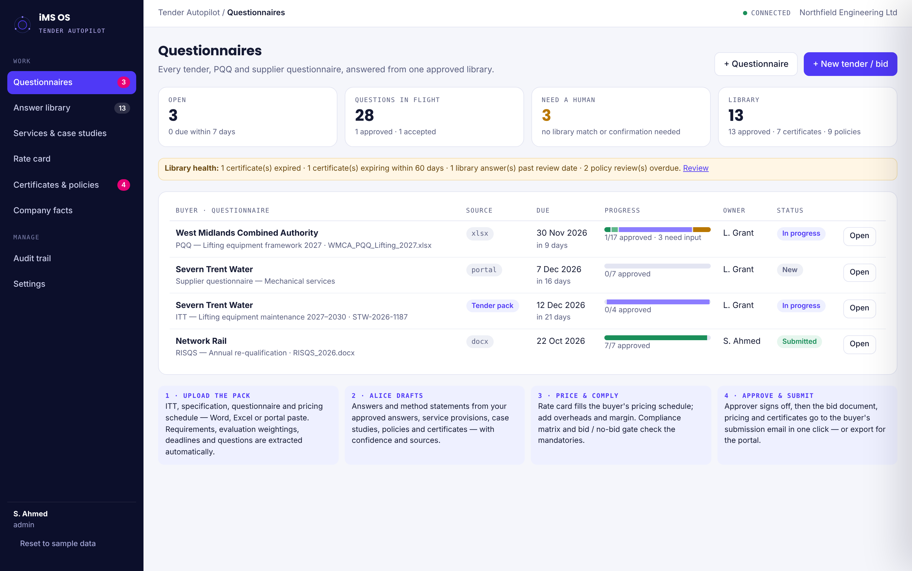
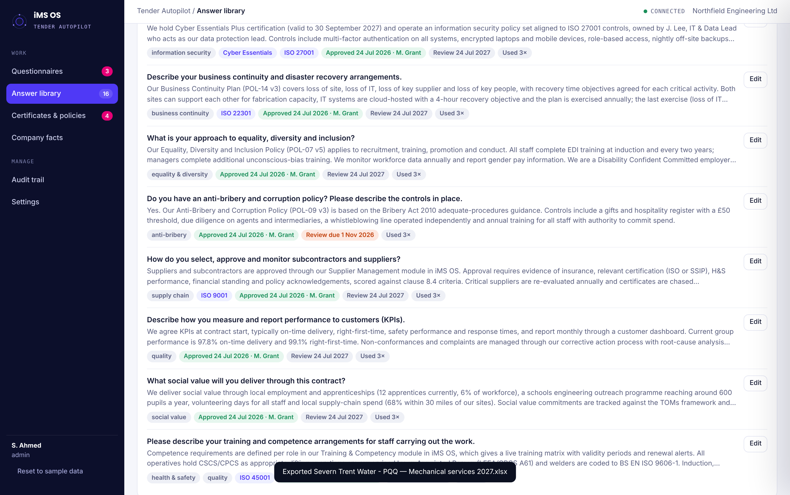
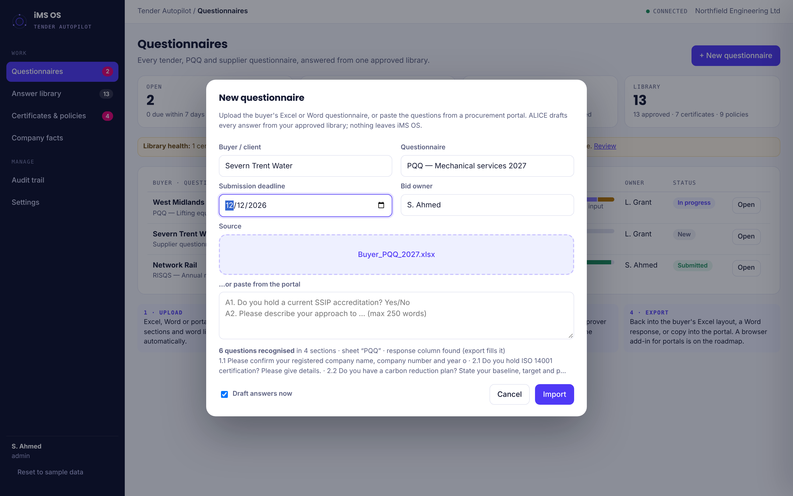
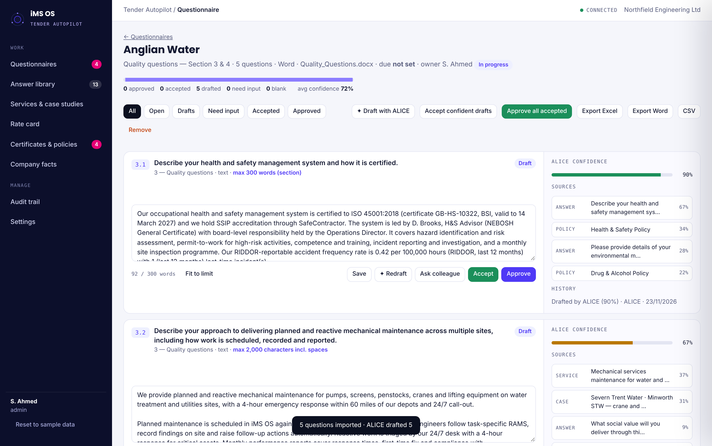
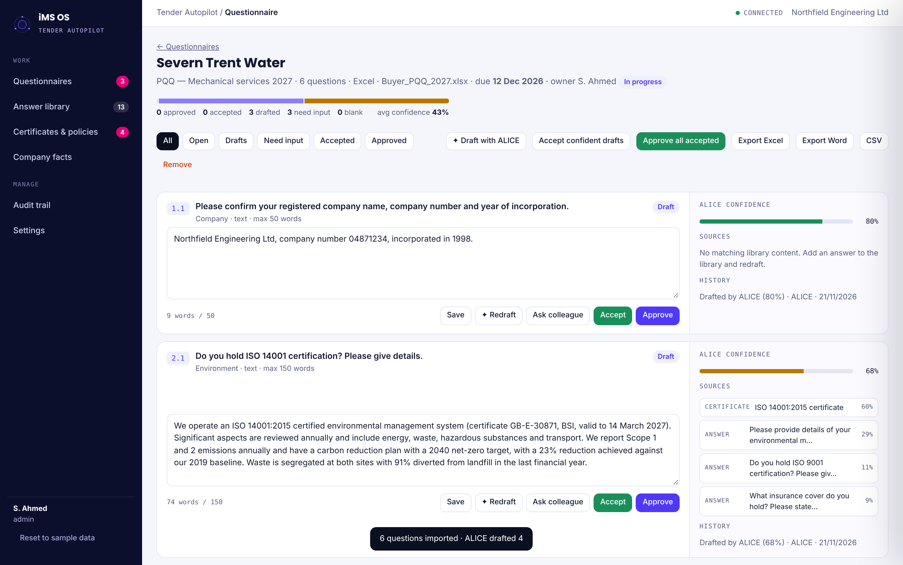
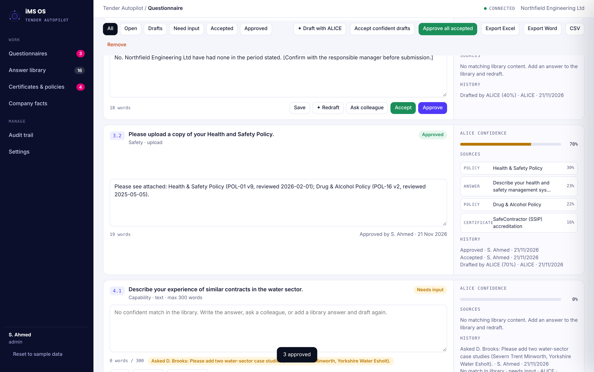
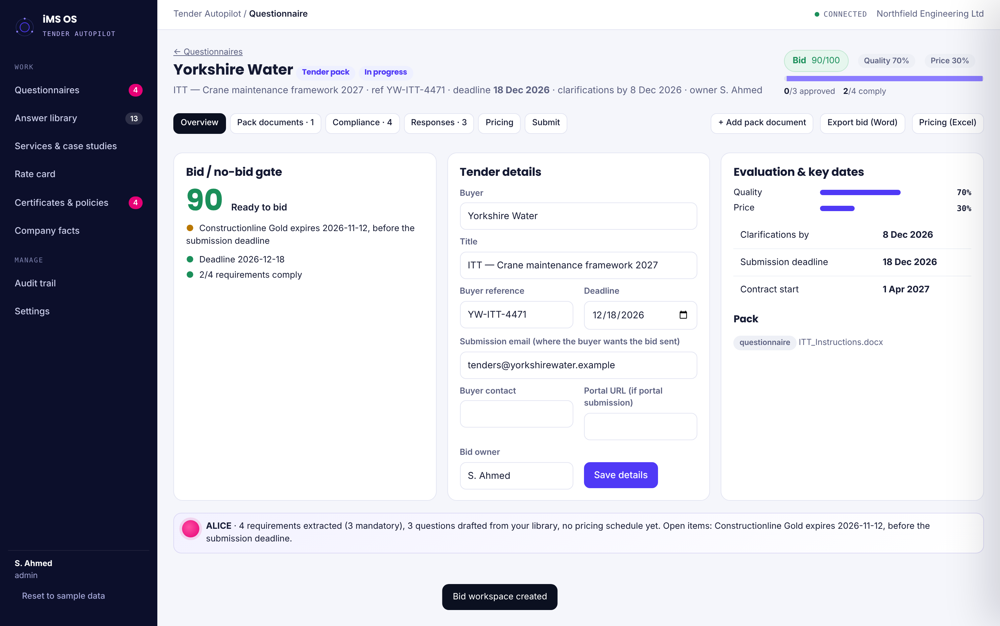
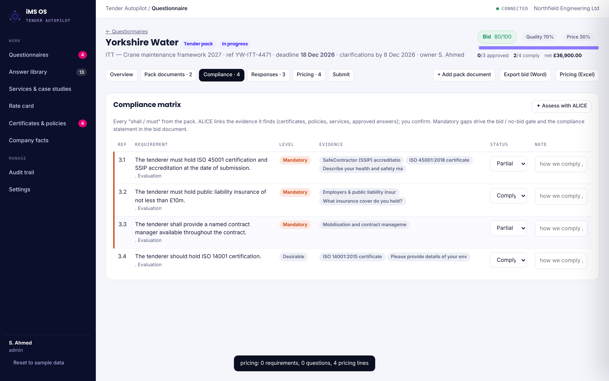
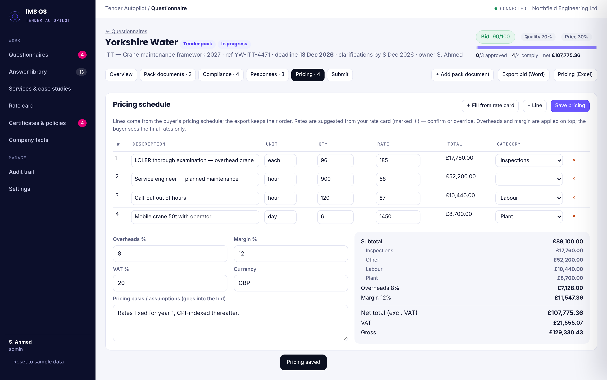
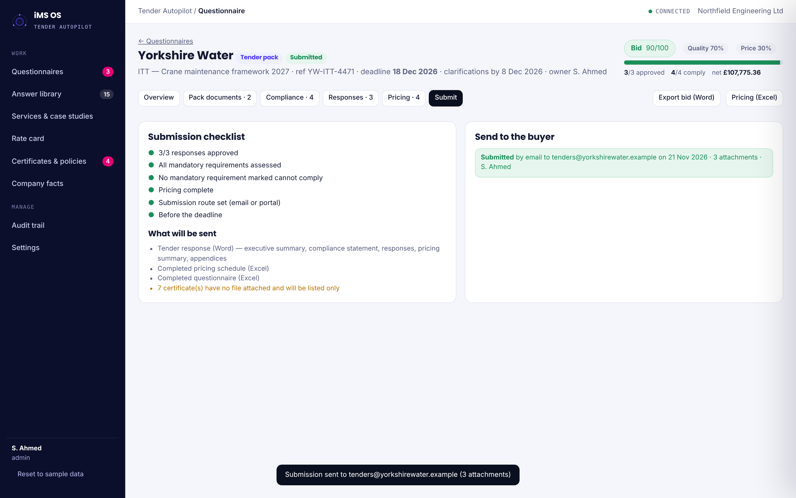

# iMS OS · Tender Autopilot — Specification

Version 1.2 · 23 November 2026 · iMS Tech Global. Developer specification for integrating the Tender Autopilot module into iMS OS. The reference implementation in this package is the behavioural spec: `public/js/rules.js` (domain rules, UMD), `server/server.js` (API), `openapi.yaml`, `server/test/` (19 tests).

## 1. Purpose and positioning

Tenders, PQQs and supplier questionnaires ask the same questions in different words. Companies answer them from memory, old bids and shared drives, miss deadlines, and send out certificates that have lapsed. Tender Autopilot gives an iMS OS tenant a single approved library and lets ALICE do the first draft of every answer, the compliance check and the pricing fill — with people reviewing, approving and submitting.

What makes it market-leading rather than another "AI bid writer":

1. **It sits inside the compliance system.** Certificates, policies, training, suppliers and incidents already live in iMS OS, so answers cite live evidence and the gate knows when a certificate expires *before the deadline*.
2. **Private by design.** The library is tenant-scoped behind the iMS OS login; drafting retrieves only this tenant's approved content and ALICE never invents facts. Nothing is sent to a buyer until an approver clicks.
3. **The whole pack, not just the questionnaire.** ITT, specification, pricing schedule in; requirements, weightings, dates, questions and pricing lines out; bid document, priced schedule and compliance statement back.
4. **It learns.** Every approved answer refreshes the library with a review date, so the next bid starts from a better place.
5. **It submits.** Email submission with the files attached, recorded in the audit trail; portal add-in on the roadmap.



## 2. Functional specification

### 2.1 Library (behind the login)
| Collection | Fields | Rules |
|---|---|---|
| `answers` | question, answer, tags[], standards[], owner, approvedBy/At, reviewBy, uses, source{qid,buyer}, evidence[] | Approving a questionnaire answer learns it here (`learn`): exact-question match or similarity > 0.55 refreshes the existing answer, else adds one. Answers shorter than 40 chars or "see attached" are not learned. `reviewBy = approvedAt + settings.reviewMonths`; past review date = stale (lower confidence, flagged). |
| `certificates` | name, body, number, standard, scope, issued, expires, fileId | Expiry drives `libraryHealth` (warn within `certWarnDays`, expired) and the gate. |
| `policies` | name, ref, version, reviewed, nextReview, owner, summary, fileId | Summary is used verbatim in drafts; overdue reviews flagged. |
| `services` | name, description, method, people[], tags[] | Service provisions and method statements — the source for narrative answers. |
| `cases` | client, title, sector, year, value, summary, outcome, reference | Case studies cited in "experience / case study" answers. |
| `rates` | item, unit, rate, category | Rate card used to fill pricing schedules. |
| `facts` | key → value | `{{key}}` placeholders in answers/services are filled at draft time (`fillFacts`). Factual questions (company number, headcount, turnover, RIDDOR rate, sites) are answered from facts directly (`factAnswer`). |



### 2.2 Import
* Files: `.xlsx/.xlsm` (all sheets; the sheet with most questions wins; a sheet with qty/rate columns is a pricing schedule), `.docx` (paragraphs and table rows), `.csv`, `.txt` and pasted portal text. Reader/writer is dependency-free (`public/js/zip.js`: ZIP central directory + inflate via `zlib`/`DecompressionStream`, SpreadsheetML shared strings, WordprocessingML paragraphs).
* Question detection (`fromRows`): header row with question/requirement/criteria column; ref, section, answer/response, word limit and type columns recognised by name; otherwise any cell that reads as a question (ends with `?`, or starts with please/describe/provide/confirm/do you/…). Numbering `1.2`, `A1`, `Q3`, `3.1.2a` is stripped into `ref`; `(max 250 words)` and trailing `Yes/No` are stripped into `wordLimit`/`type`; single-cell rows become section headings. Pre-filled response cells import as `edited`.
* **Response limits** (`parseLimit`): word limits, character limits (incl./excl. spaces) and page limits ("max 250 words", "no more than 2,000 characters including spaces", "Word limit: 300", "should not exceed 2 sides of A4", "within 1 page") are recognised wherever buyers put them — inside the question, in a *Word limit* / *Character limit* column, on the line after the question, or at section level ("All responses in this section are limited to 300 words"), which every question in the section inherits unless it states its own. Pages convert at 500 words/page; characters to ≈ words/6.5 for drafting. Stored as `question.limit {kind, n, spaces, inherited}`; shown on the question and in the export (`Limit`, `Count` columns).
* Types: `text | yesno | number | upload` (`classify`).
* An import with no recognised question is refused (422 `no_questions`) with guidance.



### 2.3 Drafting (`draft`, `draftAll`)
Deterministic retrieval in the reference build, ALICE in production (`server/ai.js`, `AI=alice`): retrieval runs first and only the retrieved tenant content is passed as context. Order of rules:
1. **Facts** — factual questions answered from `facts` (confidence 0.8; 0.5 with a "[Confirm…]" marker for multi-year statistics).
2. **Negative yes/no** (enforcement, prosecutions, breaches, claims, insolvency…) → "No. … [Confirm with the responsible manager]" at 0.4 → *needs input*. Never "Yes".
3. **Library answer** with cosine similarity ≥ 0.25 (TF-IDF over tokens with synonym expansion; **standard numbers are decisive** — ISO 14001 is never answered with the ISO 9001 answer). Confidence 0.45 + 0.6·score (+0.05 approved, −0.15 stale). Word limit trimmed.
4. **Narrative** questions (describe/explain/method/case studies/experience…) with service or case hits → composed answer: service description + method + key people (+ up to two case studies, cases first when the question asks for them) + governing policy.
5. **Upload** → "Please see attached: …" citing the policy or certificate (one document unless the question asks for copies/plural).
6. **Yes/no** with certificate or policy evidence → "Yes. This is evidenced by …".
7. **Policy** summary sentence.
8. Otherwise empty → *needs input* with "add to library and redraft" guidance.

**Fitting to limits** (`fitToLimit`, `limitUsage`): every draft is fitted to the question's limit at a sentence boundary (word boundary as a fallback, never mid-word); narrative answers with generous limits are extended with further services/case studies up to the limit. The UI shows a live `n / max words|chars` counter, flags over-limit answers, offers **Fit to limit**, and asks before accepting an over-limit answer.



Status: `draft` when confidence ≥ `settings.minConfidence` (0.55) else `needs-input`. Sources (kind, id, label, score) are stored on the question and shown in the UI.



### 2.4 Review workflow
`blank → draft → edited → accepted → approved`, plus `needs-input` (no match, or assigned to a colleague with a note). Contributors import/edit/accept; only `approver`/`admin` approve (403 otherwise). "Accept confident drafts" accepts every draft at/above threshold; "Approve all accepted" approves in one click. Approved answers lock and show approver/date. Questionnaire status derives from questions: `new | drafting | review | ready | submitted`.



### 2.5 Tender packs (bid workspace)
A questionnaire with `kind:'tender'` holds `documents[]`, `requirements[]`, `criteria[]`, `dates{}`, `pricing{}` in addition to `questions[]`.
* `analyseDocument(name, source, paras|rows)` classifies each uploaded file: `pricing` (qty/rate columns), `questionnaire` (≥ 3 questions), `specification` (≥ 5 requirements), `instructions`, `document`; and extracts: requirements (`shall/must/required/mandatory` → mandatory; `should/desirable/preferred` addressed to the supplier → desirable; deadline instructions such as "tenders must be submitted by…" are excluded), evaluation weightings (`Quality (60%)`, `Price 40%`, validated to ≈100 % or price/quality keywords), key dates (deadline, clarifications, contract start), questions, pricing lines.
* `addPackDocument` merges into the bid: deadline becomes `due` if unset; pricing lines replace the schedule and keep the buyer's row order; new questions are drafted; `autoAssess` links evidence to requirements (comply > 0.32 similarity, partial > 0.18) for a person to confirm.





### 2.6 Bid / no-bid gate (`gate`)
Score 100 − 35 per blocking issue − 10 per warning. Blocking: a certificate cited for a mandatory requirement expires before the deadline; a mandatory requirement marked *cannot comply*; deadline passed. Warnings: other certificates expiring before the deadline, unassessed mandatories, questions needing input, unpriced lines, ≤ 3 days left. Verdict `bid` (≥ 80, no blockers) · `review` · `no-bid-risk`.

### 2.7 Pricing (`setPricing`, `priceTotals`, `suggestRates`)
Lines {description, unit, qty, rate, category}; empty rates suggested from the rate card by similarity (> 0.3), marked ✦ until confirmed. Totals: subtotal, by category, overheads %, margin % (on subtotal + overheads), net, VAT %, gross; unpriced count. Export: Excel schedule with all lines and totals; summary paragraph in the bid; basis/assumptions text.



### 2.8 Export and submission
* Questionnaire: Excel (Ref · Section · Question · Response · Status · Evidence), Word response, CSV. Exporting with unapproved answers asks for confirmation. Every export is recorded (who, when, format, approved count).
* Bid: Word tender response (`bidBlocks`: executive summary from facts and certificates, evaluation criteria, compliance statement with per-requirement response and evidence, responses by section, pricing summary, appendix list) and the priced Excel schedule.
* **Submit to buyer** (`POST /submit`, approver): `canSubmit` requires every response approved, no unassessed/`no` mandatories, complete pricing, a submission route and the deadline not passed (approver may `force`). The mailer sends to `submissionEmail` with the bid document, priced schedule, questionnaire and every certificate that has a stored file; the questionnaire becomes `submitted` with `submission{t, to, by, attachments[], mode, id}`. Portal submissions are marked manually (`how:'portal'`).



### 2.9 Roles
`viewer` (read) < `contributor` (import, edit, accept, assess, price, library) < `approver` (approve, submit) < `admin` (settings, removals). Platform roles map onto these.

### 2.10 Library health and audit
`libraryHealth`: stale answers, certificates expiring/expired, overdue policy reviews — surfaced on the inbox and in the sidebar badge. `log[]` holds every tenant-level event; each question, answer, certificate, policy and questionnaire holds its own `hist[]`.

## 3. Data model
```
model = { org, settings{reviewMonths, approvers[], tone, minConfidence, certWarnDays, learn, submissionCc, fromEmail}, facts{},
  library:{ answers[], certificates[], policies[], services[], cases[], rates[] }, people[{id,name,role,title,email}], questionnaires[], log[] }
questionnaire = { id, kind:'questionnaire'|'tender', buyer, title, reference, submissionEmail, buyerContact, portalUrl, source, fileName, fileId, received, due, owner,
  status, questions[], documents[], requirements[], criteria[{name,weight}], dates{deadline,clarifications,contractStart}, pricing{lines[],overheadPct,marginPct,vatPct,currency,basis,buyerSheet}, priceTotals, exports[], submission, hist[] }
question = { id, ref, section, text, type, wordLimit, answer, status, confidence, sources[{kind,id,label,score}], assignee, note, approvedBy, approvedAt, hist[], meta{row, answerCol} }
requirement = { id, ref, section, text, level:'mandatory'|'desirable', status:'comply'|'partial'|'no'|'unassessed', evidence[{kind,id,label}], note, docId, auto }
```

## 4. API
See `openapi.yaml`. All routes under `/api`, bearer auth, tenant from the platform. Model polling: `GET /model` returns `version`; the UI re-fetches on change (20 s / focus). Files: `POST /files` (base64) → `{fileId,url}`; `GET /files/{id}`.

## 5. UI
Views: Questionnaires (inbox, KPIs, library-health notice, four-step explainer) · Questionnaire workspace (filters, bulk actions, per-question card with answer, word count vs limit, confidence bar, sources drawer, history; ask-a-colleague modal) · Bid workspace (Overview with gate, details incl. submission email, criteria and dates; Pack documents; Compliance matrix; Responses; Pricing; Submit) · Answer library (search, tag chips, editor) · Services & case studies · Rate card · Certificates & policies (expiry/review status, file attach) · Company facts · Audit trail · Settings. `public/css/module.css` is the shared iMS OS module shell; `tender.css` the module styles.

## 6. Integration and production notes
* Replace `auth()` with the platform gateway; map roles. Store: replace the JSON file with the platform database (one document per questionnaire is a natural unit; library collections per tenant). Files: platform document store. Mail: `mailer.send()` → notification service; keep the message contract.
* ALICE: `AI=alice` with `ALICE_URL`; prompt contract in `server/ai.js` (tenant, question, tone, facts, retrieved context, rules). Fallback to deterministic on timeout/error so drafting never blocks.
* Browser add-in (phase 2): content script reads the focused portal field's label/question, calls `POST /draft`, fills only when `autofill` is true, shows sources, and logs the fill against a questionnaire created for that portal.
* Security: tenant isolation on every route; file type allow-list; uploads virus-scanned by the platform; audit log immutable; rate-limit `/draft`.
* Tests: `npm test` (rules + API, incl. Office round-trips, pack extraction, gate, email submission to the outbox). The Playwright script used for the screens in this document exercises the full UI through the API.


## 7. ALICE integration — prompts, contract, guardrails, training and evaluation

This section is the handover for the platform team connecting the module to ALICE (`AI=alice`, `ALICE_URL`, `ALICE_KEY`). The system prompt and the output guards are implemented in `server/ai.js`; the task prompts below are the specification for the ALICE service side.

How ALICE is used in this module, the exact prompts, the input/output contract, what "training" means here, and how quality is measured. The deterministic engine in `rules.js` is the fallback and the retrieval layer; ALICE sits on top of it (`server/ai.js`, `AI=alice`).

#### 7.7.1 Principle: retrieval first, ALICE second, people last

ALICE never answers from general knowledge. For every task the module first retrieves the tenant's own approved content (answers, certificates, policies, services, case studies, facts) and hands ALICE **only that**. ALICE's job is to write well within those facts, the buyer's question and the limit. A person accepts and an approver signs off before anything leaves iMS OS. This is what lets us say to a customer: *the AI cannot invent a certificate, a number or a claim.*

Three consequences:
* No fine-tuning on customer data is required (and we should not do it — tenant isolation). "Training" = better retrieval, better prompts, a golden set per tenant, and the feedback loop in §6.
* Every output carries the context it used (`usedContext`) so the UI can show sources and the auditor can see provenance.
* If retrieval finds nothing, ALICE is not called; the question goes to *needs input*.

#### 7.7.2 System prompt (all tender tasks)

```
You are ALICE, the compliance intelligence inside iMS OS, drafting on behalf of {{tenant}} ("we").

Rules you never break:
1. Use ONLY the CONTEXT and FACTS provided. If they do not contain what is needed to answer, return an empty answer with confidence 0 and say what is missing in "gaps". Never invent certificates, numbers, dates, names, clients, policies or claims.
2. Copy certificate numbers, dates, standards, figures and names exactly as given in CONTEXT/FACTS.
3. Write as the tenant in the first person plural, {{tone}}. British English. No marketing superlatives unless they are in CONTEXT.
4. Respect LIMIT exactly: words means whole words; characters means characters {{spaces_rule}}; pages means 500 words per page. If the limit is generous, use it to add evidence from CONTEXT; if tight, keep the strongest evidence.
5. Yes/No questions start with "Yes." or "No.". Questions about enforcement, prosecutions, notices, breaches, claims, disputes or insolvency: never answer "Yes" unless CONTEXT states it; answer "No." only if FACTS/CONTEXT confirm it, otherwise leave empty and flag in "gaps".
6. Address what the buyer actually asked, in the order asked, mirroring their terms (e.g. "the Authority", "the Contract"). Cover every part of a multi-part question.
7. Prefer evidence over assertion: cite the certificate, policy reference and version, KPI or case study from CONTEXT. Where the evaluation criteria are given, make the points that score against them.
8. Mark anything a person must confirm before submission in square brackets, e.g. "[Confirm 2024 RIDDOR figure]". Keep such markers rare.
9. Output valid JSON matching the schema requested and nothing else.
```

`{{tone}}` comes from tenant settings (`settings.tone`, default: *Formal, first person plural ("we"), concrete and evidenced*). `{{spaces_rule}}` = "including spaces" / "excluding spaces" / "including spaces unless stated".

#### 7.7.3 Task prompts

#### 7.3.1 Draft an answer (`POST ALICE_URL`, task `draft`)
Input (built by `server/ai.js`):
```json
{ "task": "draft", "tenant": "Northfield Engineering Ltd", "tone": "…",
  "question": { "ref": "3.2", "text": "Describe your approach to …", "type": "text", "section": "Quality",
                "limit": { "kind": "chars", "n": 2000, "spaces": "incl" } },
  "criteria": [{ "name": "Quality", "weight": 60 }, { "name": "Price", "weight": 40 }],
  "buyer": { "name": "Severn Trent Water", "sector": "Water" },
  "facts": { "company": "…", "employees": "186", "accidentRate": "0.42 per 100,000 hours" },
  "context": [
    { "i": 0, "kind": "answer", "label": "Describe your health and safety…", "text": "…", "approvedAt": "2026-07-01", "reviewBy": "2027-07-01", "stale": false },
    { "i": 1, "kind": "certificate", "label": "ISO 45001:2018 certificate", "text": "BSI GB-HS-10322, scope …, valid 2024-03-15 to 2027-03-14" },
    { "i": 2, "kind": "service", "label": "Mechanical services maintenance…", "text": "description + method + people" },
    { "i": 3, "kind": "case", "label": "Severn Trent Water · Minworth STW…", "text": "summary + outcome" },
    { "i": 4, "kind": "policy", "label": "Health & Safety Policy", "text": "POL-01 v9, reviewed 2026-02-01, owner D. Brooks. summary" } ],
  "previous": { "answer": "…", "editedBy": "L. Grant", "note": "buyer wanted more on reporting" } }
```
User prompt:
```
QUESTION {{ref}} ({{section}}): {{text}}
TYPE: {{type}}   LIMIT: {{limit or "none"}}   EVALUATION: {{criteria or "not stated"}}
BUYER: {{buyer}}

FACTS: {{facts as key: value lines}}

CONTEXT (numbered; cite by number in usedContext):
[0] answer (approved 2026-07-01, review 2027-07-01): …
[1] certificate: …
…

{{if previous}}PREVIOUS DRAFT (a person edited it; keep their changes unless they conflict with CONTEXT): …{{/if}}

Write the answer. Return JSON:
{ "answer": string, "confidence": 0..1, "usedContext": [int], "gaps": [string], "notes": string }
confidence: 0.9+ only when CONTEXT answers every part with current evidence; 0.6–0.8 when parts rely on inference from CONTEXT; below 0.5 when the answer is thin; 0 when empty.
```
Output handling (`ai.js`): `answer` is re-checked against the limit with `fitToLimit` (belt and braces), `confidence` is clamped to ≤ 0.97 and the stale-source penalty still applies, `usedContext` becomes the question's `sources`, `gaps` are appended as a note and push the status to *needs input* when non-empty.

#### 7.3.2 Extract from a pack document (task `extract`)
Used when regex extraction (`analyseDocument`) returns little from a long document, or always when `AI=alice`. Input: document name, type, and text in chunks of ≤ 12k characters with page/paragraph indexes. Output per chunk, merged by the server:
```
Return JSON: { "requirements": [{ "ref", "text", "level": "mandatory|desirable", "section", "para" }],
  "questions": [{ "ref", "text", "section", "limit": { "kind", "n", "spaces" } | null, "type" }],
  "criteria": [{ "name", "weight", "sub": [{ "name", "weight" }] }],
  "dates": { "deadline", "clarifications", "contractStart", "siteVisit", "presentation" },
  "submission": { "method": "portal|email|post", "email", "portal", "format" },
  "pricing": { "found": bool, "where": "sheet/section name", "model": "schedule of rates|lump sum|target cost|…" } }
Rules: a requirement is a sentence placing an obligation on the supplier/contractor/tenderer; instructions about how to submit are not requirements; keep the buyer's numbering; a limit stated for a section applies to its questions (set inherited: true); copy text verbatim, do not paraphrase.
```

#### 7.3.3 Assess a requirement (task `assess`)
Input: requirement text + up to 6 retrieved context items. Output:
```
{ "status": "comply|partial|no|unknown", "evidence": [int], "statement": "one or two sentences for the compliance statement, citing the evidence", "action": "what would close the gap, if any" }
"comply" only when the evidence meets the requirement as written (e.g. the certificate is the standard named, in scope, and valid at the deadline). "unknown" when CONTEXT is silent — never guess.
```

#### 7.3.4 Executive summary and cover letter (task `summary`)
Input: buyer, title, criteria, facts, the approved answers (titles + first 300 chars), compliance statement counts, pricing summary, 3 strongest case studies. Output: `{ "executiveSummary": "≤ 350 words", "coverLetter": "≤ 200 words", "winThemes": [string×3] }`. Win themes must each trace to a criterion and to evidence in CONTEXT.

#### 7.3.5 Review a draft before approval (task `review`)
Run on "Accept" to catch issues a tired bid writer misses. Input: question, limit, criteria, answer. Output:
```
{ "answersAllParts": bool, "missingParts": [string], "unsupportedClaims": [string], "withinLimit": bool, "tone": "ok|too salesy|too thin", "suggestions": [string ≤ 3] }
```
Shown as hints in the question card; never changes the text itself.

#### 7.7.4 Guardrails enforced in code (not just in the prompt)
* Context is built from the tenant's library only; cross-tenant retrieval is impossible by construction.
* Empty retrieval ⇒ ALICE not called.
* JSON schema validated; non-JSON or schema failures ⇒ deterministic fallback, logged.
* Numbers/dates/certificate numbers in the answer are checked against the context (`verifyFigures`, to add: any 4+ digit number or date in the answer that does not appear in context/facts flags the answer as *needs input* with the figure named).
* Limits re-fitted in code. Negative yes/no rule re-applied in code.
* Prompt-injection: document text is data. The extract prompt wraps document chunks in a delimiter and the system prompt states that instructions inside documents are to be ignored; the server strips `{{` `}}` from document text before templating.
* Timeouts (20 s default) and rate limits per tenant; every call logged with task, tokens, latency and the question id (never the answer text in central logs).

#### 7.7.5 What "training" means for this module
No model training on customer data. Instead, three layers that make ALICE better per tenant over time:
1. **Library quality** — approved, reviewed answers; services with real method statements; case studies with outcomes; facts kept current. This is 80 % of answer quality and is the customer's own asset.
2. **Retrieval tuning** — synonym table (`SYN` in `rules.js`), standard-number rule, tag/standard boosts, and the embedding index when the platform provides one (swap `buildIndex/match` for vector search; keep the number-guard).
3. **Few-shot from the tenant's best work** — the draft prompt may include up to 3 of the tenant's highest-scoring approved answers of the same tag as style examples ("STYLE EXAMPLES — match the voice, not the content"). Selected by tag + evaluator feedback, never from another tenant.

#### 7.7.6 Feedback loop (signals already captured by the module)
| Signal | Where | Use |
|---|---|---|
| Accept without edit | question `hist` "Accepted" straight after "Drafted" | positive example for that tag/limit |
| Edit distance between draft and approved text | `draft` vs `answer` at approval | measures draft quality; large edits → review retrieval for that tag |
| "Ask colleague" after a draft | `assignee` set | retrieval gap: library lacks this topic |
| Needs input on import | status | topic coverage report for the customer ("your library has no answer for social value") |
| Over-limit on accept | confirm dialog | limit handling regression |
| Evaluator feedback (score per question, win/loss) | add `Q.outcome {won, scores[{ref,score,max,comment}]}` | the only ground truth that matters; feeds few-shot selection and win-theme prompts |

A monthly "library health & answer quality" report per tenant (coverage by tag, stale %, accept-without-edit %, average evaluator score) is the product's own evidence that ALICE is getting better.

#### 7.7.7 Evaluation set and acceptance thresholds
Golden set shipped with the module: `server/test/golden/*.json` (to create) — 40 real-style questions across H&S, quality, environment, infosec, social value, modern slavery, insurance, case studies, method statements and negative yes/no, each with the expected properties (must cite X, must start with No., must be ≤ limit, must not contain Y). Run nightly against both engines. Release gate:
* 0 fabricated figures (any number/date not in context) — hard fail.
* 100 % limit compliance.
* ≥ 90 % "cites the expected evidence".
* ≥ 80 % rated "acceptable without edit" by two bid writers on a 20-question sample.
* Negative yes/no: 100 % never "Yes".

#### 7.7.8 Outputs the customer sees
Draft text with confidence and sources; gaps as bracketed markers and notes; compliance statements; executive summary and cover letter; review hints; the audit line "Drafted by ALICE (67%) · fitted to max 2,000 characters". Never a free-text chat answer without sources in this module.
