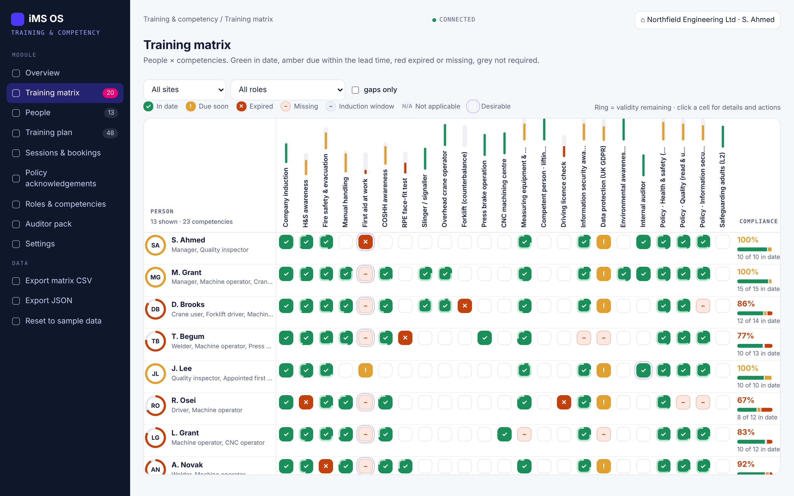
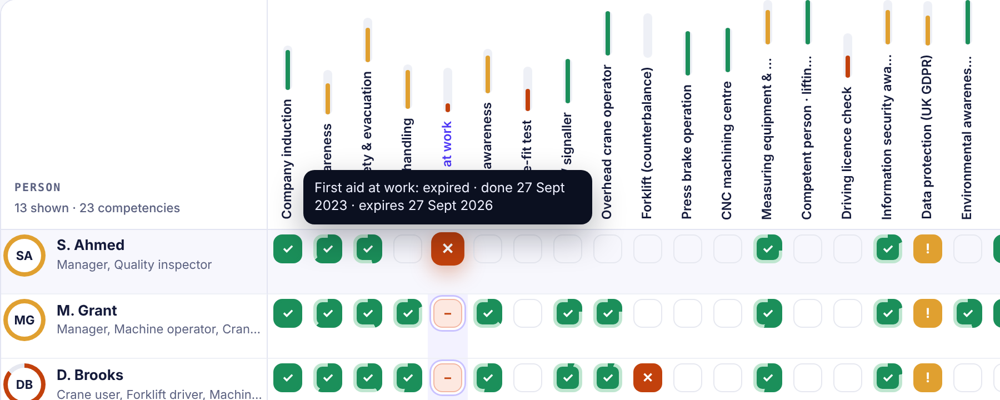
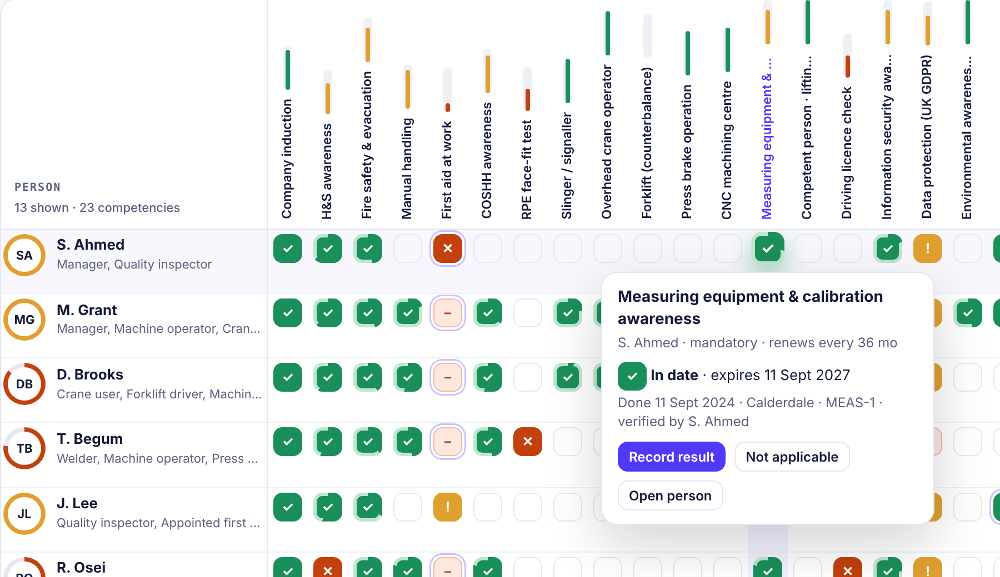
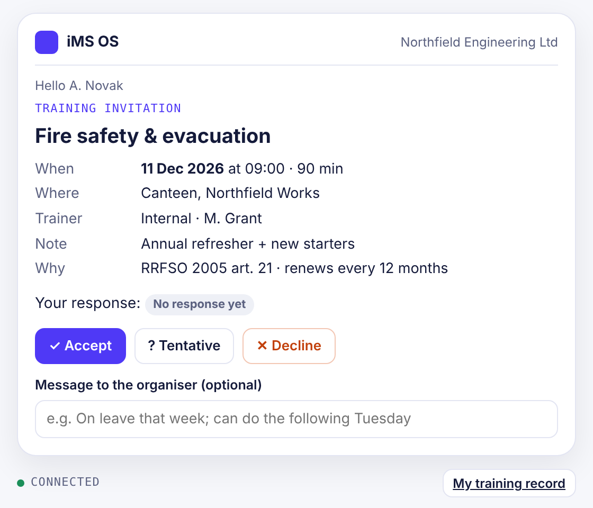
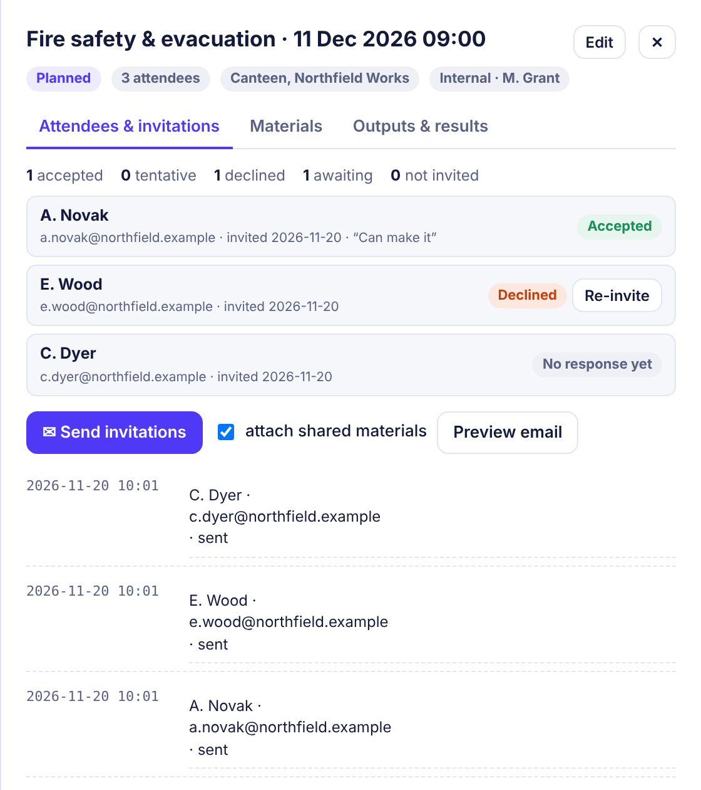
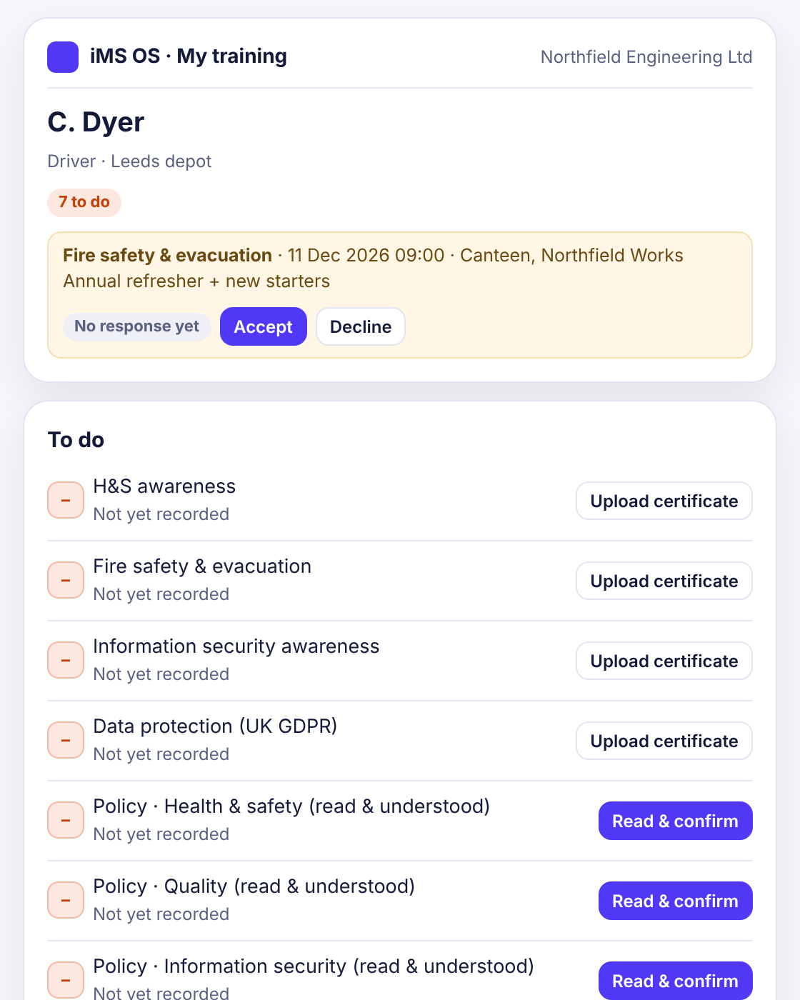

# iMS OS · Training & Competency module — developer specification

Version 1.2 · 20 November 2026 · iMS Tech Global

## 1. Why a stand-alone module

Competence has its own owners (HR, line managers), its own audit questions (ISO 9001 7.2/7.3, ISO 45001 7.2/7.3, ISO 27001 A.6.3, CQC, SIA, FORS) and four consumers inside iMS OS (assets, suppliers, policies, incidents). It therefore ships as a module with a service interface (`/competent`) rather than a feature inside another module. It brings every employee into iMS OS through the "my training" page.

## 2. What auditors look for, and where the module answers it

| Standard / regulation | Requirement | Where |
|---|---|---|
| ISO 9001 7.2 a) · ISO 45001 7.2 | Determine the necessary competence per role | Roles & requirements; auditor pack §1 |
| ISO 9001 7.2 b) | Ensure persons are competent on the basis of education, training or experience | Records with evidence type per competency; matrix |
| ISO 9001 7.2 c) | Take actions to acquire competence and evaluate effectiveness | Plan, sessions, results (Pass / observations / Fail); readiness "next 90 days booked" |
| ISO 9001 7.2 d) · 7.5.3 | Retain documented information as evidence | Certificate reference / document id mandatory for certificate-type items; history |
| ISO 9001 7.3 · ISO 45001 7.3 | Awareness of policy, objectives, their contribution | Policy acknowledgements with quiz, renewed yearly |
| ISO 45001 7.3 / induction | New starters inducted | Induction window (`inductionDays`), readiness check, auditor pack §4 |
| PUWER 1998 reg 9 · LOLER 1998 reg 8 | Adequate training for work equipment; competent persons | Competencies with `covers`; `isCompetent()`; asset module gate |
| ISO 27001 A.6.3 · A.6.5 | Security awareness; responsibilities after termination | IG/GDPR competencies; leavers dated and excluded |
| COSHH reg 7 / 12 | Face-fit, information and training | Face-fit (24 months), COSHH awareness |
| First Aid Regs 1981 · RRFSO art. 21 | First aiders; fire safety training | First aid (36 months), fire (12 months) |
| CQC (care) · Care Act 2014 | Safeguarding levels, supervision | Safeguarding competencies; roles per service |

## 2b. Matrix presentation (build to this)

The matrix is the page auditors and managers live in, so it carries more than colour. The reference implementation in `public/` is the visual spec; the screens below are from it.



| Element | Rule | Where |
|---|---|---|
| Person avatar ring | Conic ring = share of **mandatory** items in date (`personSummary`); green when 100 % with nothing due, amber when something is due, red when anything is expired or missing. Initials inside. Click opens the person. | `.avatar` (CSS vars `--pct`, `--col`) |
| Compliance column | `pct = (ok + soon) / total` of mandatory items, with a 3-segment bar (in date / due / missing-expired) and "n of m in date". | `.pct`, `.mini` |
| Column holder bar | Vertical bar above each competency name = people who hold it ÷ people who need it (N/A excluded); ≥ 90 % green, ≥ 60 % amber, else red. Title shows the numbers. | `.colbar` |
| Cell states | ✓ green in date · ! amber due within `leadDays` · ✕ red expired · – outlined pink missing · ~ dashed induction window · N/A grey exempt · lilac halo = desirable (not mandatory) · empty outline = not required. | `.cellb.{ok,soon,over,none,grace,na,des,req}` |
| Validity ring | In-date cells draw a conic ring that **empties as the renewal date approaches** (`--left` = days remaining ÷ validity months × 30.4), so a 36-month competency with 6 months left is visibly running down before it turns amber. | `.cellb.ok` |
| Tooltip | Dark tooltip on hover: competency, state, done date, expiry date and days left, exemption reason. Hidden on click. | `[data-tip]`, `.tip` |
| Popover | Click a cell: title, person · mandatory/desirable · renewal period, current record (provider, ref, verifier), actions **Record result · Not applicable · Open person** (Book when a session is planned). Not-applicable asks for a reason and writes history. | `#pop`, `openPop()` |
| Row/column highlight | Hovering a cell tints its row and column; filters: site, role, gaps only. | `td.hl`, `th.hl` |





## 3. Data model

See `openapi.yaml` schemas. Key points: a person's requirements are the union of the "all" role, their roles, and their `extra` list; a requirement's state is computed from the latest non-Fail record and the competency's `months`; `grace` applies inside the induction window for new starters.

## 4. Rules (server-side; `rules.js`)

`requirements`, `latestRecord`, `cell` (none/grace/ok/soon/over), `matrixRow`, `gaps` (severity order), `personSummary`, `isCompetent`, `validateRecord`/`addRecord` (evidence, date, result), `acknowledgePolicy` (quiz complete and correct), `validatePerson`, `markLeaver`, `planSession`/`completeSession`, `plan`, `readiness` (10 checks), `matrixCsv`.

## 5. Roles and permissions

| Role | Can |
|---|---|
| viewer | read matrix, people, plan, auditor pack |
| self (link token or signed-in employee) | read own record; acknowledge policies; upload a certificate (marked "to verify") |
| manager | everything: people, records (verified), sessions, roles, settings |

Recommended refinement: line managers verify records for their own reports; HR/quality verify all.

## 6. Service interface for other modules

`GET /competent?personId=&covers=<asset category | policy id>` → `{ ok, reason, competencies | required }`. A competency "covers" a category when its `covers` array lists it; the person must hold a valid (unexpired, non-Fail) record for at least one covering competency. If no competency covers the category the answer is `ok: true` with a reason, so categories without a competence requirement are not blocked. The Inventory & Asset module calls this before accepting an inspection/calibration result when `TRAINING_API` is set.

## 6a. Tenant tailoring

Everything an organisation needs to change lives in data, not code: the competency catalogue (`competencies[]`, each with renewal months, evidence type, basis, `covers`, quiz, provider, archived flag), the role requirements (`roles[]`), and `settings` (lead days, induction window, site label and list, providers, self-service and verification rules, link lifetime, reminder days, invitation template). Rules: `upsertCompetency`, `archiveCompetency` (records retained, leaves the matrix and roles), `upsertRole`, `removeRole` (never "all"), `updateSettings` (validated). All changes append to `log[]` with who/when/what, shown on the Change log tab and `GET /log`.

## 6b. Sessions, invitations, materials, outputs

A session carries date, time, duration, location, trainer, provider, cost, note, attendees (staff and external people), `materials[]`, `outputs[]`, `invites[]`, status Planned/Completed/Cancelled. `buildInvite` renders the tenant template (`{{name}} {{course}} {{date}} {{time}} {{location}} {{provider}} {{trainer}} {{materials}} {{org}}`), appends the person's self-service link, and `buildIcs` produces an RFC 5545 VEVENT (METHOD:REQUEST) so the invite lands in Outlook/Google calendars. `POST /sessions/{id}/invite` sends through `mailer.js` (outbox by default; swap for the platform's transport), optionally attaching shared files, and records each result. Outputs uploaded after the session are linked as `fileId` on every record written at completion; `Absent` writes a history line instead of a record.

**RSVP.** The template also renders `{{accept}}` and `{{decline}}` — one-click links `{rsvpBase}{sessionId}/{personId}?a=accept|decline` (`GET /r/:sid/:pid` → `index.html?rsvp=sid|pid&a=…`). The response page needs no login: it shows the session details, shared materials and Accept / Tentative / Decline with an optional note, and posts `POST /sessions/{id}/rsvp` with `X-Self-Token` (production: the signed token from the link). The `.ics` carries `ORGANIZER` (tenant `organiserEmail`) and `ATTENDEE;RSVP=TRUE;PARTSTAT=NEEDS-ACTION`, so a reply from Outlook/Google can be mapped to the same endpoint by the mail integration. `session.rsvp[personId] = {status, note, t}`; `rsvpOf`/`rsvpSummary` derive accepted / tentative / declined / pending (invited, no answer) / not-invited. Declined attendees are excluded from the plan's booked set; a manager can re-invite them or anyone in one click, and the "my training" page lets a person answer later. Only Planned sessions accept responses.







Sample invitation body (template is tenant-editable in Settings; `docs/invite-sample.txt`):

```
Hello C. Dyer,

You are invited to Fire safety & evacuation on Friday, 11 December 2026 at 09:00 (Canteen, Northfield Works).

Please let us know whether you can attend:
  Accept:  https://training.ims-os.com/r/ses1/p12?a=accept
  Decline: https://training.ims-os.com/r/ses1/p12?a=decline
```

## 7. Self-service

`GET /t/{token}` → module in self mode: outstanding items first, actions (read & confirm with quiz; upload certificate), booked sessions, full record. Production tokens are signed and expire; the QR/link is issued from the person's record (People → QR / link) and can be printed into the induction pack.

## 8. Reminders and automation

`remindersDue(model, now)` (exposed as `GET /reminders`, run by `server/remind.js` daily) returns: session reminders at 7 and 1 days for invitees who have not declined (with their current RSVP so the wording can nudge the undecided); expiring items at `leadDays` and 14 days to the person and their manager; expired items on the day. The job hands each to `mailer.js`; on the platform, wire it to the scheduler and the notification service. For equipment competencies the asset custodian is also notified on expiry. Alice reads `/gaps`, `/plan`, `/readiness` to answer "who is due BLS?", "book the five due in December", "are we audit-ready on 7.2?".

## 9. Non-functional

No dependencies, no build; UTC date maths; append-only history per person; 422/403/404 error contract; path-traversal-safe static; body limit 2 MB; labelled inputs, keyboard-operable matrix cells with `aria-label`, print styles for the matrix and auditor pack.

## 10. Decisions for the product owner

1. Default renewal periods (H&S awareness 36 months, fire 12, IG/GDPR 12, face-fit 24, FLT 36, first aid 36) — all overridable per tenant.
2. Who may verify self-uploaded certificates (line manager vs quality).
3. Whether a failed policy quiz locks the person out of related systems until passed.
4. Self-service token lifetime (suggested 90 days).
